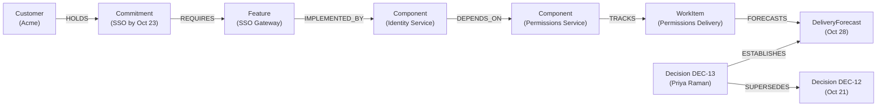

# When an Engineering Date Slips, Who Breaks a Promise? 
## How we built Ripple using FalkorDB to predict broken customer commitments before they happen.

*By Jay Bhanushali and the Ripple Team (Ashwin, Pavan, Abhijeet, Jay)*  
*Track 3 (Company Brain) Hackathon Entry — WeMakeDevs x FalkorDB*  
*Live Demo: [ripple-graph-hackathon.onrender.com](https://ripple-graph-hackathon.onrender.com/)*

---

It’s 3:45 PM on a Friday. An engineering lead posts a routine comment on a backend Jira ticket:

> *"Permissions microservice cutover delayed from Oct 21 to Oct 28 due to schema migration hurdles. Updated decision logged."*

To the engineering team, it’s a 7-day slip. Routine. Sensible. Under control.

**To enterprise sales, it is a catastrophic, silent detonation.**

Why? Because three hops down the stack, the Enterprise Single Sign-On (SSO) feature depends on that identity service. And the SSO feature was promised to **Acme Corp** with a hard contractual SLA of **October 23**—backed by a \$500k renewal guarantee.

Nobody notified the Account Executive. Nobody notified the VP of Engineering. The customer won't find out until October 24 when their onboarding call fails.

In fast-growing software companies, **commitments and code live in entirely different universes**:
- Sales promises live in Salesforce and signed PDFs.
- Requirements live in Notion and Productboard.
- Engineering schedules live in Linear, Jira, and GitHub.
- Architecture dependencies live in engineers' heads and stale draw.io diagrams.

When an upstream dependency moves, the ripple effect travels silently through your software supply chain until it breaks a promise to a customer.

We built **Ripple** to solve this.

---

## Why Standard AI & Vector RAG Fail at this Problem

When we set out to build the "Company Brain" for Track 3 of the FalkorDB Hackathon, the most common suggestion we received was: *"Why not just chunk all your Jira tickets, Slack notes, and Salesforce contracts into a Vector Database and ask an LLM?"*

Here is why **Vector Search completely fails at organizational causality**:

```
[Customer Acme] 
       │ 
    (holds)
       ▼
[Commitment: SSO by Oct 23]
       │
   (requires)
       ▼
[Feature: SSO Gateway]
       │
(implemented by)
       ▼
[Component: Identity Module]
       │
  (depends on)
       ▼
[Component: Permissions Service] ◄── [Decision DEC-13: Slips to Oct 28]
```

1. **Similarity is not Causality**: An internal Slack update saying *"Permissions service delivery moves to Oct 28"* has **zero semantic similarity** to *"Acme Corp Enterprise SSO SLA Oct 23"*. An embedding model has no mathematical reason to pull them into the same semantic cluster.
2. **Multi-Hop Blindness**: An engineering delay ripples through a 5-to-7 hop path (`Commitment → Feature → Component → Dependency → WorkItem → Decision`). Vector RAG cannot compute transitive closures or graph traversals without hallucinating.
3. **No Temporal Truth**: In standard RAG, if ticket #12 says "Forecast Oct 21" and ticket #13 says "Forecast Oct 28", the LLM sees both chunks and either averages them or guesses. It doesn't understand that `Decision DEC-13` **supersedes** `Decision DEC-12`.

To know which customer promises are broken, you don't need semantic similarity. **You need a graph.**

---

## Enter Ripple: The Dynamic Commitment & Dependency Engine

**Ripple** is a real-time, graph-powered intelligence system built on **FalkorDB** and **FastAPI**, backed by a bounded AI assistant and an editorial React/TypeScript workspace.

It turns company records into a living, queryable dependency graph:



When an engineering lead pastes an informal decision note into Ripple:

```text
"Approved: permissions service delivery moves from October 21, 2026 to October 28, 2026. 
Owner: Priya. This replaces decision DEC-12."
```

Ripple executes an atomic pipeline:
1. **Preview & Entity Extraction**: Parses the component, date change, author, and superseded decision code. Server assigns an immutable preview with a monotonic version lock.
2. **FalkorDB Atomic Cutover**: In a single graph transaction, FalkorDB cuts the forecast edge, creates `DEC-13 -[:SUPERSEDES]-> DEC-12`, links `DEC-13 -[:ESTABLISHES]-> Forecast(Oct 28)`, and bumps the graph knowledge revision.
3. **Instant Ripple Traversal**: FalkorDB traverses the transitive dependency tree back to every active customer commitment in sub-milliseconds.
4. **Immediate Conflict Detection**:
   - **Acme**: ⚠️ **DATE CONFLICT** (Oct 28 delivery violates Oct 23 SLA).
   - **Birch**: ⚠️ **DATE CONFLICT** (Oct 28 delivery violates Oct 26 SLA).
   - **Cedar**: ✅ **NO CONFLICT** (Independent component path).
   - **Delta**: ✅ **NO DETECTED CONFLICT** (SLA is Nov 5, comfortably after Oct 28).

---

## The Secret Sauce: Real Graph Queries (Cypher)

FalkorDB gave us the superpower of expressing complex organizational dependency chains in clean, declarative Cypher.

Here is the exact Cypher traversal Ripple runs to trace dependency impacts from a slipped component all the way back to customer contracts:

```cypher
MATCH (c:Customer)-[:HOLDS]->(comm:Commitment)-[:REQUIRES]->(f:Feature)
      -[:IMPLEMENTED_BY]->(comp:Component)
OPTIONAL MATCH (comp)-[:DEPENDS_ON*0..10]->(upstream:Component)
      -[:TRACKS]->(w:WorkItem)-[:FORECASTS]->(df:DeliveryForecast)
MATCH (w)<-[:ESTABLISHES]-(d:Decision)
WHERE comm.status = 'active'
RETURN 
    c.name AS customer,
    comm.id AS commitment_id,
    comm.target_date AS customer_sla,
    comp.name AS downstream_feature,
    upstream.name AS blocking_component,
    df.target_date AS latest_forecast,
    d.code AS latest_decision,
    (df.target_date > comm.target_date) AS is_violated
```

Because FalkorDB is built on GraphBLAS and executes in-memory over the Redis protocol, this multi-hop traversal executes in **under 2 milliseconds**. 

---

## 4 Architecture Decisions That Made Ripple Stand Out

We didn't want to build a superficial hackathon prototype. We wanted to build something an enterprise VP of Engineering could trust on day one.

### 1. "Prove It's the Graph" — The Interactive Scissors
Judges and users are skeptical of AI demos. Anyone can hardcode an alert. 

So in Ripple's UI, we built an interactive graph inspector with a **"Cut Dependency" tool (✂️)**. 
- You can sever the `Identity Migration → Permissions Service` edge live in the UI.
- The moment you cut the edge, Acme’s conflict flag disappears in real-time.
- Restore the edge, and the conflict reappears.
- Click **"Show the Cypher"**, and the UI displays the exact query and traversal path. 

This proved unequivocally that the system is governed by graph topology, not LLM imagination.

### 2. Upstream Blocker Ownership Resolution (The R1 Rule)
When a promise breaks, standard tools notify the customer success manager or the downstream feature engineer. But they can’t fix the delay!

Ripple implements **Upstream Blocker Resolution**:
- If Acme’s SSO is blocked because the Permissions microservice slipped, Ripple walks the dependency chain to the root blocking component.
- It identifies the exact engineer who owns that blocking component (**Priya Raman**) and assigns the escalation draft to them.
- If ownership across multiple blocking work items is ambiguous, Ripple refuses to guess—it flags `needs_verification` with an explicit ownership warning.

### 3. Monotonic Evidence Versioning (`<dataset_id>:<revision>`)
LLM agents notoriously suffer from dirty writes and stale context. If the graph updates while an agent is generating an escalation, it will draft actions based on outdated facts.

Ripple enforces an opaque version tuple on every API response (e.g. `200c1575b9cd4ce08f292f02b281af8b:1`). Any mutation or agent invocation must pass `expected_version`. If another engineer committed a change in the meantime, the mutation is rejected with **HTTP 409 Stale Evidence**.

### 4. Bounded Agent with Citation Highlighting
Our agent is not an autonomous bot making unverified promises. It operates under strict boundaries:
- **Read-Only Graph Tools**: 6-call maximum budget.
- **Strict Evidence Citation**: Every claim cites the exact `source_id` and document excerpt.
- **Interactive Source Drawer**: Clicking any source chip highlights the exact sentence inside the original decision memo or sales brief.
- **Drafts, Never Auto-Send**: The agent generates internal escalations and customer update drafts for human review; it never communicates with customers autonomously.

---

## What We Learned (The Hard-Earned Lessons)

Building Ripple across a weekend taught our team fundamental lessons about graphs, LLMs, and organizational data:

### 1. Graphs Turn "Tacit Knowledge" into Hard Logic
Before this hackathon, we viewed knowledge graphs as nice-to-have visualizers. We came out of it convinced that **graphs are the only viable foundation for enterprise intelligence**. 
Organizational risk is inherently topological: it is about who reports to whom, what depends on what, and which decision supersedes which plan. Flattening that structure into vector text chunks throws away the very relationships that matter.

### 2. Constraints Make Agents Better, Not Worse
Our first instinct was to let the agent do everything: automatically reschedule dates, rewrite Jira tickets, and draft emails. We quickly realized that unconstrained agency produces unpredictable chaos in production.
By bounding the agent to 3 specific question types, forcing it to consume read-only graph tools, and mandating human review before any action is persisted, the tool became something enterprise leaders actually want to use.

### 3. FalkorDB is Ridiculously Fast
Integrating FalkorDB via Python was one of the smoothest parts of the hackathon. Having Cypher run on top of an in-memory Redis-based architecture gave us instant query responses. Even complex variable-length path queries (`-[:DEPENDS_ON*0..10]->`) executed so quickly that live UI filters felt instantaneous without needing caching layers.

### 4. Rigor Wins: 271 Tests in a Hackathon
Hackathons are famous for "it works on my machine" demos that crash when the judge clicks the wrong button. We took the opposite approach:
- **271 passing backend tests** in pytest covering health probes, R1 owner resolution, idempotency replays, and concurrency locks.
- **49 passing frontend component tests** in Vitest.
- Fully containerized 1-command startup (`docker compose up --build`).
- Live production deployment on Render.

When your system handles broken customer promises, your code shouldn't make broken promises either.

---

## Try Ripple Live!

The project is live, fully documented, and open source:

- 🌐 **Live Application**: [https://ripple-graph-hackathon.onrender.com/](https://ripple-graph-hackathon.onrender.com/)
- 💻 **GitHub Repository**: [github.com/jaybhanushali/graph-hackathon](https://github.com/jaybhanushali/graph-hackathon)
- 🎥 **Interactive Tour**: Reset the demo graph, confirm the sample permissions memo, watch the ripple map flag Acme & Birch, cut the graph edge to see Acme clear, and inspect the Cypher query!

---

*Big thanks to WeMakeDevs and FalkorDB for hosting an incredible hackathon! Building the "Company Brain" with native graph reasoning was one of the most exciting engineering challenges we've tackled.*
