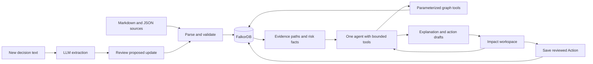

# Ripple — hackathon implementation plan

Prepared October 17, 2026. Recommendation: enter Track 3, Company Brain. The team now has four developers: Ashwin, Pavan, Abhijeet, and Jay. Jay owns the frontend. Use the [team implementation plan](TEAM_IMPLEMENTATION_PLAN.md) and individual implementation files for current ownership, shared contracts, and build order. The sixteen-hour sequence below is the original solo estimate; the team plan replaces it with parallel work and integration checkpoints. Estimates are planning estimates, not measured build times. Implementation has not started.

**1. The decision**

Build an agent that answers: **“An internal plan changed. Which customer promises are now at risk, why, and who needs to act?”**

Pitch: “Ripple connects engineering decisions to customer commitments. Change a dependency’s delivery date and it finds the affected promises, shows the evidence path, and prepares an accountable follow-up.”

| Track | Fastest credible version | Deadline risk | Assessment |
| --- | --- | --- | --- |
| 1: Connected-data agents | A bounded investigator with graph tools and one action | Medium: needs a convincing domain and action | Good alternative, but requires choosing a domain now |
| 2: Memory and coordination | Persistent memory plus an update/handoff demonstration | Higher: meaningful memory evaluation and coordination take time | Avoid for this deadline |
| 3: Company Brain | A bounded company workflow with sourced relationships | Low to medium with synthetic exports; high with live SaaS integration | Best combination of delivery speed and a clear story |

These are engineering judgments, not organiser scores or predictions about competitors. Track 3 is quick only when scoped to one workflow. A general enterprise assistant is too broad. Enter Track 1 as well only if the completed agent genuinely demonstrates graph-driven action; do not build extra features to collect track labels. Cross-session persistence alone is not a compelling Track 2 entry.

The published deadline is October 18, 2026, 11:59 PM IST. The track description explicitly values ownership, decision provenance, current knowledge, and sourced answers. See the [event overview](https://www.wemakedevs.org/hackathons/falkordb) and [schedule](https://www.wemakedevs.org/hackathons/falkordb/schedule). I found no weighted judging rubric in the reviewed overview, rules, resources, or schedule.

**2. Research and the product bet**

Enterprise search, citations, expert finding, and drafting are established capabilities. [Glean documents all four](https://docs.glean.com/user-guide/about/what-is-glean), and [Rovo combines connected search, chat, and actions](https://www.atlassian.com/software/rovo/guides/end-user-guide/how-to-use-rovo). “Ask your company anything” therefore offers weak differentiation.

Temporal graph infrastructure is also established: [Graphiti supports evolving facts and FalkorDB](https://github.com/getzep/graphiti). [FalkorDB’s GraphRAG SDK supports typed extraction and evidence retrieval](https://github.com/FalkorDB/GraphRAG-SDK). Our contribution should be the specific commitment-risk workflow, verifiable rules, and its user experience. Do not claim invention of temporal graphs or graph reasoning.

Product hypothesis: delivery teams can miss the downstream effect of an engineering decision because the promise, dependency, and account owner live in different records. This is a plausible hypothesis, not a validated customer finding. If possible, spend 15 minutes asking a founder or engineering lead for an anonymised example; do not make interviews a build dependency.

Choose Ripple over two alternatives: an onboarding assistant is easy but overlaps heavily with established assistants; a departing-employee knowledge-risk map needs a credible expertise model. Commitment impact has a visible trigger, a checkable outcome, and a short demo.

**3. The exact demonstration**

Use a clearly labelled fictional B2B SaaS company, Harbor. All people, customer values, sources, and decisions are synthetic.

Starting state:

- Customer Acme has an open commitment: enterprise SSO by October 23.
- SSO requires identity migration, which requires the permissions service.
- The accepted permissions forecast is October 21.
- A sales handoff records Acme’s promise. A project brief records the dependency. An engineering ticket records the forecast. An ownership file identifies the engineering and account owners.
- Customer Birch has another promise using the same dependency, due October 26. Customer Cedar’s October 23 commitment uses an independent component. Customer Delta has a later November commitment on the permissions path.

Live trigger: paste an engineering note: “Approved: permissions service delivery moves from October 21 to October 28. Owner: Priya. This replaces decision DEC-12.” The system extracts a proposed update and shows its source text. The user confirms it.

The agent should then:

1. Identify Acme and Birch as commitments with dependency dates beyond their deadlines.
2. Show Cedar as unaffected and Delta as having no detected date conflict. Avoid calling any customer universally “safe.”
3. Explain the chain from the changed component through dependencies to each promise and customer.
4. Show the previous and current forecast with citations.
5. Route engineering clarification to Priya and the customer update to the account owner.
6. Draft an internal escalation and a customer update. The customer draft requests a revised plan; it must not invent a new delivery promise.
7. Save the reviewed follow-up as an Action in FalkorDB and retain it after refresh/restart.

The moment to remember: **one source changes; two previously unrelated customer cards become actionable, with an inspectable chain of evidence.**

**4. Scope to ship**

The must-have product is one workspace with an affected-commitments list, selected evidence path, source drawer, and action panel. A compact question box can sit above this workspace. Avoid making the main screen an empty chat window.

| Capability | Minimum implementation | Done when |
| --- | --- | --- |
| Company ingestion | Local Markdown documents and JSON exports representing chat, tickets, ownership, and handoffs | Every imported record has a stable ID and viewable source |
| Relationship reasoning | Bounded Cypher traversal through delivery dependencies | Returned risks change when a relevant edge changes |
| Knowledge update | Confirm a parsed decision; preserve forecast history | Before/after queries show the correct forecasts |
| Agent | One tool-calling agent with a bounded loop | Trace exposes tools, parameters, evidence, and outcome |
| Follow-up | Generate drafts and save a reviewed Action | Refresh retains the action and its evidence links |
| Reliability | Reset fixtures, readable error states, local launch | A fresh checkout reproduces the demo |

Defer OAuth, live workspace sync, multi-agent orchestration, document crawling, embeddings, access-control systems, automatic sending, billing, and mobile layouts. Use one public synthetic workspace. A new input typed by a judge should work through the same pipeline as the rehearsed input.

**5. Architecture and stack**

Use React + Vite + TypeScript for the interface, FastAPI + Pydantic for the server, and the official FalkorDB Python client. Use one existing LLM account with structured output and tool calling; select its model after a small extraction/tool-call smoke check. Pin versions and the database image after that check.

The [official Python client](https://github.com/FalkorDB/falkordb-py) supports direct queries and read-only queries. [Parameterized Cypher](https://docs.falkordb.com/commands/graph.query) keeps domain logic explicit and reviewable.



FalkorDB owns entities, dependencies, forecast history, provenance, and actions. Source bodies can also be stored on Source nodes at this scale. Do not maintain a second in-memory relationship graph that can silently replace FalkorDB. JSON is import input, not the runtime answer store.

Skip Graphiti and GraphRAG SDK in the critical path. Both are relevant options, but adopting their extraction and storage abstractions while also implementing a precise domain model adds integration work. Use schema-constrained extraction plus direct queries for this deadline. Do not install both and write synchronisation code.

**6. Graph contract**

| Node | Important properties |
| --- | --- |
| Customer | id, name, synthetic_contract_value |
| Commitment | id, title, due_at, status |
| WorkItem | id, name, kind: feature/component/project |
| Forecast | id, available_at, valid_from, valid_to, recorded_at, status |
| Decision | id, summary, decided_at, status |
| Person | id, name |
| Team | id, name |
| Source | id, type, title, body, source_timestamp, content_hash |
| Action | id, kind, draft, status, created_at, evidence_version |

```text
Customer   -HAS_COMMITMENT-> Commitment
Commitment -REQUIRES->       WorkItem
WorkItem   -DEPENDS_ON->     WorkItem
WorkItem   -HAS_FORECAST->   Forecast
Decision   -REVISES->        WorkItem
Decision   -SUPERSEDES->     Decision
Person     -OWNS->           WorkItem
Person     -ACCOUNT_OWNER->  Customer
Person     -MEMBER_OF->      Team
Team       -RESPONSIBLE_FOR-> WorkItem
Commitment -SUPPORTED_BY->   Source
Forecast   -SUPPORTED_BY->   Source
Decision   -SUPPORTED_BY->   Source
Action     -ADDRESSES->      Commitment
Action     -ASSIGNED_TO->    Person
Action     -BASED_ON->       Decision
```

All proof-bearing edges, including customer/commitment, requirement, dependency, and ownership edges, carry source_id. Use explicit IDs and a small alias dictionary for names. Never merge people solely by display name. An unrecognised or ambiguous entity requires selection before any mutation.

Store times as UTC epoch milliseconds and display them in IST. Define date-only commitments as end of that day in IST. Forecast validity is a half-open interval: valid_from <= as_of < valid_to; absent valid_to means still active. On a confirmed update, close the old forecast interval and add the new forecast in one mutation. Deterministic decision/source IDs make replay idempotent. Serialise updates for this single-workspace MVP.

The history models accepted forecasts over time. recorded_at is audit metadata; this is not a full bitemporal database. Support normal forward updates first. Backdated or conflicting updates enter review instead of silently replacing accepted facts. A later timestamp alone does not establish authority.

Dependencies remain static for the demo; forecasting history is the temporal feature. Label that limit in the README. Detect dependency cycles on import and cap traversals at four edges, with a visible warning when deeper analysis is needed.

**7. Core reasoning rules**

The primary flag is “date conflict”: an open commitment has at least one required dependency whose accepted available_at is later than the promise’s due_at. This establishes a schedule inconsistency under the recorded dependency model, not a probability of breach or proof of financial loss.

Show a separate “needs verification” state for missing forecasts, conflicting accepted evidence, unresolved entities, or absent ownership. Never convert missing evidence to a green status. No risk score is necessary: sort by nearest due date, then optional synthetic account value. If showing value totals, deduplicate customers and label them “contract value associated with flagged accounts,” not expected loss.

Illustrative query contract below; validate syntax and returned paths against the pinned FalkorDB instance during implementation:

```cypher
MATCH (c:Customer)-[:HAS_COMMITMENT]->(k:Commitment)
MATCH (k)-[:REQUIRES]->(root:WorkItem)
MATCH p=(root)-[:DEPENDS_ON*0..4]->(w:WorkItem)
MATCH (w)-[:HAS_FORECAST]->(f:Forecast)
WHERE k.status = 'open'
  AND f.status = 'accepted'
  AND f.valid_from <= $as_of
  AND (f.valid_to IS NULL OR $as_of < f.valid_to)
  AND f.available_at > k.due_at
RETURN c.id, k.id, k.due_at, w.id, f.id, f.available_at, p
LIMIT 100
```

Group duplicate paths by commitment in the response, retaining each evidence path. Add separate parameterized queries for missing/conflicting forecasts, owners, source records, historical forecasts, and saved actions. A capped result is incomplete analysis: expose truncation in the UI.

**8. Agent and ingestion behavior**

Tools: resolve_entity, find_impacted_commitments, get_evidence, get_owners, get_forecast_history, and draft_followup. The UI’s reviewed save endpoint handles graph mutation. Limit the agent to six tool calls and return a useful partial result when evidence is incomplete. Use the client’s read-only query method for agent retrieval. No arbitrary model-generated Cypher.

Example request: “What changed for Acme, and who should handle it?” The model resolves Acme, retrieves graph facts, checks the sources and owners, then explains and drafts. It may choose different tools for a historical question. The trace shows structured tool activity and retrieved evidence, not private chain-of-thought.

The model extracts proposals and writes readable text. Graph queries establish affected IDs and dates. Check output entity IDs, cited source IDs, and numeric facts against the tool results. Reject unsupported fields. If generation fails, show the graph’s factual results with a plain template; explicitly indicate the drafting failure. If FalkorDB fails, show unavailable analysis rather than a cached success.

Build deterministic ingestion first. Seed files include structured IDs and mappings. Then add one honest unstructured path: paste a new decision, extract work_item_id, available_at, supersedes_id, owner_id, evidence_quote, and source_id; validate the exact quote and references; show the proposed delta; confirm; mutate; rerun impact queries. Do not claim unrestricted understanding of arbitrary company corpora.

Source documents are evidence, not instructions to the agent. Any follow-up records the evidence version; if a newer decision arrives, flag the draft for re-review before saving.

Suggested API surface:

```text
GET  /health
POST /demo/reset
POST /ingest                 # known fixture format
POST /decisions/preview      # text -> validated proposed delta
POST /decisions/confirm      # versioned, idempotent graph mutation
GET  /impacts?as_of=...
GET  /sources/{id}
POST /agent/run
POST /actions               # save reviewed draft, recheck version
```

**9. Data and verification**

Start with four customers, eight people, two teams, twelve work items, and roughly twenty small source records. Increase only if the demo needs another case. Publish the fixture source files beside their expected outcomes.

Construct at least these cases before UI polish:

| Case | Expected result |
| --- | --- |
| Direct dependency moves beyond deadline | Flag commitment with matching source |
| Two-hop dependency moves beyond deadline | Flag with full path |
| Shared dependency affects two customers | Two distinct affected commitments |
| Unrelated component changes | No new flag |
| Dependency still precedes promise deadline | No date-conflict flag |
| Forecast missing | Needs verification |
| Owner missing | Escalation required; no invented person |
| Two unresolved forecasts conflict | Review required |
| Same source/decision imported twice | No duplicate facts or actions |
| Before and after decision timestamp | Correct historical/current forecast |
| API/database restart | Facts and reviewed actions persist |
| Database unavailable | Honest failure state |

Also edit a source with contradictory text and exercise an ambiguous entity name. All cited excerpts must match stored sources. Remove one critical dependency edge: the corresponding reachability-based flag must disappear; restore it and the flag returns. This ablation demonstrates that graph relationships drive the result. Compare exact commitment IDs and evidence IDs, not whether the model’s prose sounds plausible.

Report measured results only after running these cases. Targets: every fixture matches expected affected IDs; every displayed factual claim has supporting evidence; direct impact queries complete within one second on the tiny demo graph. These are acceptance targets, not achieved benchmarks. Do not claim graphs universally outperform a SQL implementation or all RAG systems.

**10. Sixteen-hour build order**

| Focused time | Work | Exit condition |
| --- | --- | --- |
| 0–1 hour | Freeze scope, author four-customer story and expected results | A human can explain every expected flag |
| 1–3 hours | Docker/persistence, graph schema, seed importer, Cypher | CLI returns correct impacted IDs and sources |
| 3–5 hours | Update/history logic, owner lookup, API, early deployment probe | Decision confirmation changes live query results |
| 5–7 hours | Agent tools, source validation, bounded extraction preview | A new input follows the real pipeline |
| 7–10 hours | Impact list, evidence path, source drawer, action review | Full workflow runs in the browser |
| 10–11 hours | Save actions, stale-draft checks, reset and restart | Workflow persists and rehearsals reset cleanly |
| 11–13 hours | Fixture checks, negative cases, clean-checkout setup | Acceptance cases run repeatably |
| 13–16 hours | Finish hosting or local setup, README, demo recording, submit | Complete, reviewable submission |

By October 18 at 8:00 PM IST, freeze features. Aim to submit by 10:00 PM IST; preserve the final two hours for upload or submission trouble. Move this earlier if the focused-hour estimate exceeds remaining time. Keep a sleep block; these are work hours, not a continuous overnight schedule.

If only eight hours remain: use the same fixtures, direct queries, one decision-review form, one agent tool flow, a fixed SVG evidence layout, and local setup. Cut general questions, decorative animation, contract-value totals, the time slider, and external connectors. Preserve provenance, a live update, and a saved action.

If graph-backed before/after results do not work by hour five, stop building frontend features and fix that path. If hosting takes more than 45 additional minutes after the early probe, finish the reproducible local deliverable and demo video. A live deployment is desirable, but submission quality must not depend on resolving infrastructure at the last minute.

**11. Plugins and skills**

I checked plugin availability. GitHub, Slack, and Linear are available but were not installed when checked. A GitHub suggestion was issued; installation/connection is not confirmed. The plan does not depend on it.

| Tool | Worth using now? | Role and boundary |
| --- | --- | --- |
| GitHub plugin | Yes, if quick to connect | Review code/CI and manage the public submission repository. Useful for building; not a runtime data pipeline |
| Slack plugin | Defer | Adds account setup without proving graph reasoning. Use synthetic Slack-shaped JSON |
| Linear plugin | Defer | Use synthetic ticket exports and an internal saved Action. Add a real adapter after the hackathon |
| Sites plugin | Low priority | Consider only if its hosting fits the actual backend; a frontend alone does not host FalkorDB |
| FalkorDB MCP / Graphiti MCP | Defer | Direct domain tools already give the agent graph access. MCP transport adds little to this deadline |
| Figma / image generation | Skip for MVP | A polished evidence path and readable sources matter more than visual assets |

An assistant plugin being connected does not give the submitted application its own credentials or integration. Any runtime SaaS connector would still need an adapter and authentication. Keep development assistance and runtime architecture separate.

Available local skills: consider paint for a tightly scoped visual pass after the core works, cast for one subtle evidence-path reveal after validation, and brag only if an automated promo would save time. A direct screen recording of the functioning product is the first choice. These skills have not been applied to this project. Avoid the full bunshin workflow under this deadline.

Plugin research used the [plugin-management skill](/Users/jaybhanushali/.codex/plugins/cache/openai-curated-remote/plugin-management/0.1.0/skills/plugin-management/SKILL.md). No messages were sent to other people or external workspaces.

**12. Three-minute demo and submission**

Suggested recording length is three minutes; the reviewed rules do not prescribe that duration.

| Time | Show |
| --- | --- |
| 0:00–0:20 | “Sales promised SSO. Engineering changed a dependency. Who needs to know?” |
| 0:20–0:45 | Synthetic source records and initial commitments |
| 0:45–1:10 | Paste a new decision, inspect the extracted proposal, confirm |
| 1:10–1:50 | Two impacted customers; inspect one complete evidence chain and unaffected control |
| 1:50–2:20 | Agent tool trace, owners, citations, and follow-up draft |
| 2:20–2:40 | Save a reviewed action; refresh to show persistence |
| 2:40–3:00 | Actual Cypher, brief fixture results, and project links |

The [rules](https://www.wemakedevs.org/hackathons/falkordb/rules) require a public repository, setup and graph-model documentation, dependent queries/algorithms, a working demo video, a deployment or complete local setup, and declared tracks. They also require AI-assistance disclosure and meaningful participant understanding. They prohibit restricted/private data ingestion. Use public synthetic fixtures and keep a short record of your design choices and verification.

Suggested repository shape:

```text
README.md
IMPLEMENTATION_PLAN.md
docker-compose.yml
.env.example
backend/app/{api,agent,graph,ingest,schemas}.py
backend/queries/*.cypher
frontend/src/
fixtures/harbor/{sources,entities,decisions,expected}/
tests/test_impact_contract.py
docs/{graph-model,verification,ai-assistance}.md
```

If the core is finished early, add one optional differentiator: preview a hypothetical date change in a separate graph, compare impacted commitments, then discard the scenario. FalkorDB supports [graph copying](https://docs.falkordb.com/commands/graph.copy). Use a server-generated graph name and clean up scenario graphs. This is a stretch feature, not a prerequisite.

The submission’s strongest evidence will be a functioning dependency update, precise unaffected controls, source-backed explanations, and a durable action. Winning cannot be guaranteed; this scope gives the team a credible, distinctive product to demonstrate by tomorrow.
