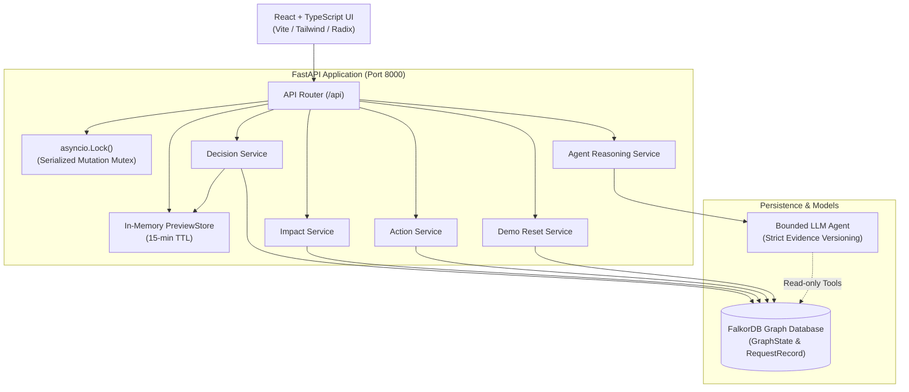

# Ripple — Dynamic Customer Commitment & Dependency Intelligence

> **Track 3 Hackathon Entry**  
> *Predicting broken promises before they happen.*

**Live demo:** <https://ripple-graph-hackathon.onrender.com/>

### 60-second tour

1. **Reset demo** (top of the page). All four promises are on track.
2. **Review decision** → *Use the synthetic sample note* → *Preview* → *Confirm*. The permissions service slips from 21 to 28 October as `DEC-13`, superseding `DEC-12`.
3. Watch **the ripple map**: the red path runs from *Permissions service* back to Acme (5 days late) and Birch (2 days late). Cedar and Delta, the controls, stay clear.
4. Click any source chip to see the exact quoted passage highlighted in the original document.
5. Ask the follow-up assistant *Who knows the most about it?*. It walks `Person -[:OWNS|DISCUSSED|MEMBER_OF]->` edges and cites the chat and ticket lines.
6. **Prove it is the graph:** cut the *Identity migration → Permissions service* edge (scissors icon). Acme clears immediately. Restore it and the flag returns. *Show the Cypher* displays the traversal that decides it.

---

## Value Proposition

In fast-paced engineering organizations, cross-functional promises to enterprise customers often break silently when upstream engineering schedules slip. A delayed internal dependency (such as a permissions microservice or auth migration) ripples through service chains, jeopardizing high-stakes SLA commitments weeks before anyone realizes it.

**Ripple** provides real-time, graph-powered intelligence that tracks customer commitments against engineering dependencies. By mapping the full dependency path—from customer contract to microservice forecast—Ripple detects date conflicts immediately when engineering decisions are made, assigns accountable component ownership, and equips teams with a bounded AI assistant to draft reviewed escalations and customer updates.

---

## Architecture Overview

Ripple combines an event-consistent graph backend with an intuitive light editorial workspace:



### Core Architecture Components

1. **FastAPI Backend with Serialized Mutation Locks**:
   - Single-worker mutation synchronization using `asyncio.Lock()` ensures race-free state transitions during decision confirmations and action persistence.
   - Synchronous FalkorDB repository operations offloaded cleanly via `asyncio.to_thread`.
2. **FalkorDB Graph Persistence**:
   - Full dependency graph modeling Customers, Commitments, Features, Components, Forecasts, and Sources.
   - `GraphState` singleton tracking active `dataset_id` and monotonic knowledge revisions.
   - `RequestRecord` persistence providing deterministic idempotency protection and replay across restarts.
3. **React + TypeScript Frontend (Vite)**:
   - Light editorial desktop workspace built for high information density.
   - Transparent side-by-side promise vs. forecast comparison, visual dependency paths, and source drawer.
4. **Bounded AI Agent**:
   - Strictly bounded to read-only graph retrieval tools under a 6-call execution budget.
   - Strict `evidence_version` validation preventing stale-context hallucinations.
   - Pure draft generator (escalations/customer updates) requiring human review prior to persistence.

---

## Prerequisites

- **Docker & Docker Compose** (Docker Desktop 24+)
- **Python 3.11+** (Python 3.12 recommended)
- **Node.js 20+** & **npm 10+**

---

## 1-Command Startup

To run the complete Ripple stack (FalkorDB + FastAPI Backend) in containers:

```bash
docker compose up --build
```

- **Backend API**: [http://localhost:8000](http://localhost:8000)
- **Interactive OpenAPI Docs**: [http://localhost:8000/docs](http://localhost:8000/docs)
- **Health Check**: [http://localhost:8000/api/health](http://localhost:8000/api/health)

---

## Local Development Guide

### 1. Start FalkorDB Container

Run FalkorDB in detached mode:

```bash
docker compose up falkordb -d
```

### 2. Backend Setup & Run

In a separate terminal:

```bash
cd backend
python3 -m venv .venv
source .venv/bin/activate
pip install -e ".[dev]"

# Start backend server with hot-reload
uvicorn backend.app.main:app --host 0.0.0.0 --port 8000 --reload
```

Verify backend health:
```bash
curl http://localhost:8000/api/health
# {"status":"ok","database":"falkordb","version":"0.1.0"}
```

### 3. Frontend Setup & Run

In a separate terminal:

```bash
npm install
npm run dev
```

The frontend development server starts at [http://localhost:5173](http://localhost:5173) with automatic proxying to `/api`.

---

## Interactive Demo Flow & Walkthrough

Ripple includes a canonical 4-customer scenario (`Acme`, `Birch`, `Cedar`, `Delta`). Follow this sequential flow to test the system end-to-end:

### Step 1: Reset Demo Graph
Initialize a clean synthetic demo state. This creates a fresh dataset identity (a 32-character hex ID) and resets the revision to `0`:
```bash
curl -X POST http://localhost:8000/api/demo/reset
```
*Response*:
```json
{
  "status": "reset",
  "dataset_id": "200c1575b9cd4ce08f292f02b281af8b",
  "evidence_version": "200c1575b9cd4ce08f292f02b281af8b:0"
}
```

### Step 2: Inspect Baseline Commitments
Query current impact statuses across all customers:
```bash
curl http://localhost:8000/api/impacts
```
*Outcome*: **0 conflicts**. All 4 commitments return `status: "no_detected_conflict"`. Upstream Permissions Service forecast is October 21, well before customer SLA dates (Acme due Oct 23, Birch due Oct 26).

### Step 3: Preview Decision Ticket
An engineering lead pastes a decision memo postponing Permissions Service delivery to October 28:
```bash
curl -X POST http://localhost:8000/api/decisions/preview \
  -H "Content-Type: application/json" \
  -d '{
    "text": "Approved: permissions service delivery moves from October 21, 2026 to October 28, 2026. Owner: Priya. This replaces decision DEC-12.",
    "source_title": "Permissions Delivery Memo"
  }'
```
*Outcome*: Generates an immutable proposal with `preview_id` (e.g. `prev_xyz`), 15-minute TTL, server-assigned `effective_at`, and extracted delivery date `1793212800000` (Oct 28).

### Step 4: Confirm Decision
Commit the decision to the graph under the active evidence version:
```bash
curl -X POST http://localhost:8000/api/decisions/confirm \
  -H "Content-Type: application/json" \
  -d '{
    "preview_id": "<preview_id_from_step_3>",
    "expected_version": "<evidence_version_from_step_1>",
    "idempotency_key": "idem_demo_confirm_001"
  }'
```
*Outcome*: Atomically cuts over the forecast, links `DEC-13 -ESTABLISHES-> Forecast`, invalidates the preview, and advances the knowledge revision by one (`…:0` → `…:1`). Confirmed decisions are numbered after the highest existing code, so this one is `DEC-13`.

### Step 5: Inspect Updated Impacts (R1 Owner Resolution)
Re-query impacts to observe the ripple effect:
```bash
curl http://localhost:8000/api/impacts
```
*Outcome*:
- **Acme (`com_acme_sso`)**: Status `date_conflict` (Oct 28 delivery violates Oct 23 SLA). Resolved engineering owner: **Priya Raman** (blocking component owner).
- **Birch (`com_birch_audit`)**: Status `date_conflict` (Oct 28 delivery violates Oct 26 SLA). Resolved engineering owner: **Priya Raman**.
- **Cedar (`com_cedar_export`)**: Control customer. Status remains `no_detected_conflict` (no permissions dependency).
- **Delta (`com_delta_sso`)**: Status remains `no_detected_conflict` (due Nov 5, after Oct 28).

### Step 6: Run Agent for Impact Analysis & Decision Lineage
Ask the bounded agent to analyze Acme's broken promise and its decision lineage:
```bash
curl -X POST http://localhost:8000/api/agent/run \
  -H "Content-Type: application/json" \
  -d '{
    "message": "Which commitments are impacted and why did permissions change from DEC-12?",
    "commitment_id": "com_acme_sso",
    "expected_version": "<evidence_version_from_step_4>"
  }'
```
*Outcome*: Returns verifiable answer with exact source citations, tool trace, and actionable draft escalations assigned to Priya Raman.

### Step 7: Persist Reviewed Follow-Up Action
Human operator reviews and saves the escalation draft:
```bash
curl -X POST http://localhost:8000/api/actions \
  -H "Content-Type: application/json" \
  -d '{
    "idempotency_key": "idem_demo_action_001",
    "expected_version": "<evidence_version_from_step_4>",
    "commitment_id": "com_acme_sso",
    "kind": "internal_escalation",
    "assignee_id": "person_priya",
    "body": "Priya: Acme SSO is promised for Oct 23. Permissions delay to Oct 28 violates customer SLA. Please confirm staging cutover options.",
    "citations": [
      {
        "source_id": "src_permissions_ticket",
        "quote": "delivery moves from October 21, 2026 to October 28, 2026"
      }
    ],
    "based_on_decision_ids": ["DEC-13"]
  }'
```
*Outcome*: Persists reviewed action draft with status `reviewed`. Listable via `GET /api/actions?commitment_id=com_acme_sso`.

---

## Documented Design Decisions & R1 Boundaries

Ripple implements the agreed architecture from `SHARED_CONTRACT.md` and Review Revision R1:

1. **Server-Assigned `effective_at` at Preview Time**:
   - The decision's effective time is assigned by the server at preview creation (`preview_created_at`), not chosen by the model or client.
   - Explicit requests for custom historical backdating or future effective times return HTTP 422 `review_required` to prevent unauthorized retroactive modifications. Future delivery forecasts remain fully supported.
2. **R1 Owner Resolution for Date Conflicts**:
   - For `date_conflict` commitments, `engineering_owner` resolves to the unique owner across all blocking WorkItems (**Priya Raman** for permissions blockers), *not* the downstream feature owner.
   - If blockers have conflicting or ambiguous ownership, `engineering_owner` is set to `null` with an explicit reason warning.
3. **Status Precedence Rules**:
   - Missing or ambiguous ownership yields `needs_verification` *unless* a confirmed date conflict exists, in which case `date_conflict` takes precedence with an unresolved-owner warning.
   - `no_detected_conflict` strictly requires complete, verified evidence along all bounded dependency paths.
4. **Opaque Evidence Versioning (`<dataset_id>:<revision>`)**:
   - All read responses include an opaque version string (e.g. `200c1575…:1`).
   - Mutations (`/api/decisions/confirm`, `/api/actions`) and agent runs enforce `expected_version`.
   - Stale versions are immediately rejected with HTTP 409 `stale_evidence`, preventing dirty writes and phantom updates.
5. **Three Bounded Question Types for Agent**:
   - The agent supports three question scopes: (1) affected customer promises and accountable owners, (2) forecast and decision lineage ("Why did this change?"), and (3) who knows what ("Who knows the most about the permissions service?"), answered from `OWNS`, `DISCUSSED` and team-membership edges with quoted sources.
   - Speculative unbounded replanning and broad Q&A are strictly deferred; dependency delays are flagged as requiring replanning, not automatically recalculated schedules.

---

## Documented System Limitations

To maintain uncompromising reliability during mission-critical decisions, Ripple enforces explicit boundaries:
- **Deterministic Seed Mappings**: The demo dataset uses synthetic, curated graph data for the Harbor platform. Seed and reset operations re-initialize this synthetic graph; general unconstrained document parsing is outside scope.
- **Server-Timed Live Updates**: Effective cutover timestamps reflect the server preview clock. Retroactive schedule surgery requires audited administrative fixtures.
- **No Automatic Downstream Replanning**: When an upstream component slips, downstream feature delivery dates are flagged as conflicting dependencies rather than automatically shifted. True engineering schedules require human architectural judgment.

---

## Testing & Quality Assurance

Ripple includes a comprehensive test suite covering health probes, R1 owner resolution rules, domain error mappings, preview/confirm workflows, agent reasoning, and idempotency protection:

```bash
# Activate virtual environment
source .venv/bin/activate

# Execute all tests with detailed verbosity
pytest tests/ -v
```

*Results*: **271 passed**, 8 skipped (opt-in TLS, restart and timing checks) with a local FalkorDB running; without FalkorDB the graph tests skip. Frontend: `cd frontend && npm test` (49 passed). See [`docs/verification.md`](docs/verification.md) for the test matrix, negative tests, and concurrency proofs.

---

## Repository Structure

```text
ripple/
├── .github/workflows/
│   └── ci.yml               # GitHub Actions CI pipeline (Python 3.12, pytest)
├── backend/
│   ├── app/
│   │   ├── api/             # FastAPI routers (health, impacts, decisions, agent, actions, demo)
│   │   ├── graph/           # FalkorDB repository integration
│   │   ├── services/        # Domain logic (impact, decision, agent, action, preview store)
│   │   ├── main.py          # FastAPI application scaffold & global error handlers
│   │   ├── schemas.py       # Pydantic contract wire models (R1 compliant)
│   │   └── settings.py      # Application configuration
│   ├── Dockerfile           # Backend container definition
│   └── pyproject.toml       # Backend package manifest and dependencies
├── docs/
│   ├── examples/            # Canonical kickoff payload examples
│   ├── implementation/      # Workstream specifications & SHARED_CONTRACT.md
│   └── verification.md      # Comprehensive verification report & test matrix
├── tests/
│   └── api/
│       ├── test_health.py   # Health, envelope, and baseline impact tests
│       ├── test_services.py # R1 owner resolution, history, and domain error tests
│       └── test_workflows.py# Preview, confirm, agent run, action, and E2E tests
├── docker-compose.yml       # 1-command startup (FalkorDB + Backend)
├── .env.example             # Environment template
└── README.md                # Project documentation
```
