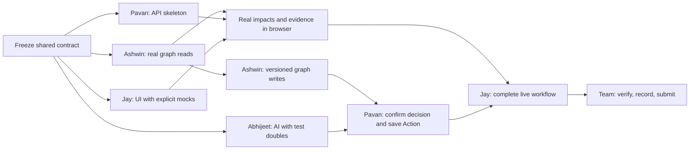

# Ripple — four-developer build plan

This is the current execution plan. The [original product plan](IMPLEMENTATION_PLAN.md) supplies the product rationale and graph model. This document replaces its solo schedule. Assignments reflect Jay's request to own the frontend. No application code has been implemented yet.

Review revision R1: use the accepted [review decisions](docs/implementation/REVIEW_UPDATES.md) and revised shared contract. All four developer files now carry the same forecast provenance, server-owned effective time, owner selection, and two-question scope. This updates requirements; it does not claim the kickoff handoffs or application implementation are complete.

**Ownership**

| Developer | Owns | Individual instructions | Branch |
| --- | --- | --- | --- |
| Ashwin | FalkorDB, graph queries, fixtures, forecast history, graph mutations | [Ashwin](docs/implementation/ASHWIN_IMPLEMENTATION.md) | `feat/ashwin-graph` |
| Pavan | FastAPI, ingestion/update services, action APIs, infrastructure, integration | [Pavan](docs/implementation/PAVAN_IMPLEMENTATION.md) | `feat/pavan-api` |
| Abhijeet | Decision extraction, tool-calling agent, grounded explanations and drafts | [Abhijeet](docs/implementation/ABHIJEET_IMPLEMENTATION.md) | `feat/abhijeet-agent` |
| Jay | Frontend, evidence-path interaction, decision review, action review, demo presentation | [Jay](docs/implementation/JAY_IMPLEMENTATION.md) | `feat/jay-frontend` |

Read your own file and the [shared contract](docs/implementation/SHARED_CONTRACT.md) before starting. The shared contract is the agreed starting specification, not a claim that an API already exists. It is maintained by Pavan after the initial team review.

**Kickoff handoff — before integration**

Within the first thirty minutes, Ashwin and Pavan agree exact typed repository signatures and graph errors; Pavan publishes Pydantic models and JSON examples for baseline/changed impacts, decision lineage/history, preview/confirm, agent complete/partial, saved Actions, and stale/expired errors. Abhijeet and Jay use those examples. Everyone can start their independent scaffold immediately; do not guess competing schemas while waiting for the handoff.

Confirm these fixed decisions: `Decision -ESTABLISHES-> Forecast` with source-backed baseline decisions; keep `DEC-12`; live effective_at is server preview time; engineering owner comes from blocking items during a conflict; missing/ambiguous ownership is incomplete evidence. Ashwin documents GraphState/RequestRecord and provides complete sources for all four controls. There is no additional approval stage or product redesign.

**Build chronology**

Times are elapsed working hours from the team's kickoff, assuming everyone is available together. Plan roughly ten hours to a verified submission candidate and two hours of buffer. Keep time for sleep. Do not multiply the solo estimate by four or use the extra people to add features.

| Window | Ashwin | Pavan | Abhijeet | Jay | Required handoff |
| --- | --- | --- | --- | --- | --- |
| 0:00–0:30 | Agree IDs, dates, graph methods | Freeze API schemas, file ownership, versions | Agree AI interfaces and model access | Agree screen states and payload examples | All four accept the shared contract |
| 0:30–2:00 | Seed graph; implement current impacts, sources, owners | Scaffold server, schemas, settings, Compose and API examples | Build provider wrapper, extraction and agent against test doubles | Scaffold app and all screens against explicit mock responses | Small scaffold changes merged; everyone can run their part |
| 2:00–4:00 | Deliver real read methods; implement atomic versioned writes | Connect real impact/source APIs; ingestion and reset; probe hosting | Connect real graph tools; validate decision extraction | Replace mock impact/source data with live API | Browser shows real graph-backed evidence by hour four |
| 4:00–6:00 | Finish forecast update/history and Action persistence | Wire preview/confirm, agent route and action save; handle conflicts | Deliver reviewed extraction, tool loop and checked draft output | Wire preview/confirm, before/after refresh, agent and action editing | Live new decision changes flags and produces grounded drafts |
| 6:00–8:00 | Run graph fixtures and edge-removal check | Run end-to-end, replay/version/restart checks; stabilise deployment | Run grounding and AI failure checks | Finish states, stale-data handling and responsive demo layout | Saved Action survives restart; negative cases pass |
| 8:00–10:00 | Write graph-model/query notes | Finish README/setup and integration report | Write AI disclosure/limits; verify tool trace | Polish readability and record demo | Complete submission candidate |
| 10:00–12:00 | Fix graph defects only | Coordinate fixes and submission upload | Fix agent defects only | Re-record only if needed; help submit | Buffer, not new scope |

By October 18 at 8:00 PM IST, freeze features; aim to submit by 10:00 PM IST. If those clock times arrive earlier than the windows above, shorten scope immediately. The previously researched deadline is October 18, 11:59 PM IST; consult the organiser's submission panel for any subsequent change.

**Dependencies and the critical path**

Only the first thirty-minute agreement is fully sequential. After that, test doubles and response examples unblock parallel work. The actual critical path is graph reads → API → browser → confirmed update → persistent Action. Agent development runs alongside it and must join by hour six.

**Ownership boundaries**

- Ashwin exclusively edits `backend/app/graph/`, `backend/queries/`, `fixtures/harbor/`, graph tests, and `docs/graph-model.md`.
- Pavan exclusively edits backend entry points/settings/wire schemas, `backend/app/api/`, `backend/app/services/`, backend dependency manifests/lockfiles, root Compose/environment setup, CI, README, and API/integration tests.
- Abhijeet exclusively edits `backend/app/ai/`, AI tests, and AI-assistance/grounding documentation. He requests Python dependency additions from Pavan.
- Jay exclusively edits `frontend/`, including its package manifest/lockfile and client-side API types, plus demo notes and frontend checks.
- Avoid a shared `utils.py`. Put functions inside the owning module. Do not restructure another person's module without an agreed handoff.
- Pavan owns the shared contract after kickoff. A field change requires agreement from affected consumers before code changes; update response examples in the same change.

Use package directories for graph and AI, not the original plan's single `graph.py`/`agent.py` suggestion. API code calls services; services call graph/AI modules. Graph code never imports API or AI modules. AI code never imports API routes or server startup.

**Working together in Git**

Use one branch per person from the same updated `main`. Push small, runnable changes at the two-, four-, and six-hour gates. Pavan coordinates integration into `main`; each developer is responsible for resolving conflicts in their owned files. Use focused pull requests or coordinated merges; keep the relevant smoke check passing after each merge. Branch names here are instructions, not branches already created.

At each handoff, include the exact entry point, command to run, returned shape, and known limits. A screenshot alone is not a backend handoff. Each consumer verifies the real dependency rather than assuming a mock proves integration.

**Acceptance gates**

1. By hour two, every module imports/runs independently and every owner uses the agreed IDs and fields.
2. By hour four, the browser fetches live impacts and source excerpts from FalkorDB. Stop UI polish if this fails.
3. By hour six, paste → preview → confirm updates live flags using server preview time. The agent uses real graph tools for impact/owners and decision lineage with checkable citations. No mock runtime fallback.
4. By hour eight, save a reviewed follow-up, restart, and retrieve it. Confirm replay, stale-version rejection, basic preview expiry, one overlapping-confirmation check, separate historical fixtures, missing evidence, and unrelated-customer controls work. Rehearse a different valid delivery date and verify its actual graph-derived result.
5. By hour ten, a clean checkout runs from the README and the demo recording shows the working product.

If behind, cut the history slider, fancy graph animation, general company Q&A, contract-value totals, and CI expansion before removing the core checks. Fall back to complete local setup if hosting blocks submission. Keep accepted history in storage, the two bounded question types (impact/owners and decision lineage), a readable stale/expired message, source evidence, decision review, and a persisted Action. Elaborate stale-state visuals are optional; rejecting stale actions is not. Expertise ranking, additional document-extraction pipelines, automatic schedule recalculation, OAuth, Slack sync, multi-agent coordination, a second graph framework, and a side-prize blog stay deferred until the core is verified. A blog must not consume submission/fix buffer.

**Submission ownership**

Pavan assembles repository/setup/deployment links and submits with Jay. Ashwin provides model/query documentation and measured graph checks. Abhijeet provides AI-assistance disclosure, agent limitations, and measured grounding checks. Jay provides the working demo video and final visual review. All four rehearse explaining their part and one complete evidence path. A working synthetic dataset is required; real private workspace data is outside this build.
