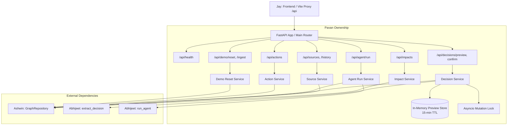

# Pavan — API, workflow services, infrastructure, and integration

You own the boundary that makes the four workstreams one product. Publish stable schemas first, connect Ashwin's graph and Abhijeet's AI modules, and give Jay a working API early. You coordinate integration and setup; the other owners remain responsible for defects in their modules.

Read the [team sequence](../../TEAM_IMPLEMENTATION_PLAN.md) and [shared contract](SHARED_CONTRACT.md). Branch: `feat/pavan-api`.

**Review revision R1 — apply before integration**

- Publish exact Pydantic models, typed graph/AI interfaces with Ashwin/Abhijeet, and example JSON for baseline/changed impacts, history, preview/confirm, agent complete/partial, Actions, and 409/410 errors during kickoff. This unblocks parallel consumers.
- Preserve non-nullable decision_id: Ashwin supplies one establishing Decision per Forecast, including source-backed baselines. Keep `DEC-12`; no ID-style migration.
- Assign live effective_at from server preview creation time after extraction. Reject explicit custom historical/future decision-effective times with 422 review_required. A future delivery date remains valid. Confirm against the stored preview and active interval, not a comparison that rejects every time earlier than now.
- Follow R1 engineering-owner selection and missing-owner status precedence; do not replace a component owner with the feature owner or select the first of several people.
- Verify GraphState/RequestRecord persistence, full Cedar/Delta provenance, and reset dataset semantics with Ashwin. Keep basic stale/expiry/replay behavior and one overlapping-confirmation check.
- Integrate two bounded question types: impact/owners and decision lineage. Document recorded downstream forecasts versus conflicting dependencies; no automatic schedule recalculation.
- Defer broad CI, expertise ranking, additional seed-extraction pipelines, and side-prize work until the working submission is verified.

See the [review disposition](REVIEW_UPDATES.md); integration ownership and time gates remain unchanged.

**Files you own**

```text
backend/app/__init__.py
backend/app/main.py
backend/app/settings.py
backend/app/schemas.py
backend/app/api/*
backend/app/services/*
backend/pyproject.toml and backend lockfile
backend/Dockerfile
docker-compose.yml
.env.example
.gitignore
.github/workflows/*
tests/api/*
tests/integration/*
README.md
docs/verification.md
docs/implementation/SHARED_CONTRACT.md
```

Jay owns frontend manifests and Dockerfile if needed. Ashwin owns graph imports/mutations and fixtures. Abhijeet owns provider, extraction, and agent code. Agree their dependency needs in kickoff; you make backend manifest/lockfile changes centrally.

**First thirty minutes**

Agree and publish shared Pydantic models and exact typed graph/AI signatures under R1. Publish the example payload set listed above, including baseline establishing decisions, component-owner choice, review timestamps, errors, completeness, nullable owners, and opaque evidence_version. Ask Jay to mirror these fields in TypeScript. Choose backend/frontend ports and a local Vite proxy so everyone uses `/api` without guessing origins.

Keep one API worker for this deadline. Mutating services use a shared lock; atomic version predicates remain inside Ashwin's graph writes. Preview storage may be process-local with an expiry; persistent facts and idempotency records live in FalkorDB.

**Hours 0:30–2:00: scaffolding and contract delivery**

1. Scaffold FastAPI, settings, error mapping, schemas, and explicit development response examples. Keep mocks in test/dev support and make their mode visible.
2. Compose the database and backend; coordinate the frontend service with Jay. Use an internal database connection and a persistent volume. Pin the working database image and dependencies after a real smoke check.
3. Expose `/api/health`, document local startup, and verify another teammate can run it.
4. Define route/service files for impacts, sources/history, ingestion/reset, preview/confirm, agent runs, and Actions.
5. Hand Jay exact base URL, response examples, and which routes are already real. Give Abhijeet a test invocation of his async entry points.

Do not wait for all graph methods before building routes; dependency injection and explicit test doubles should unblock your work.

**Hours 2:00–4:00: connect the real graph**

Wire real `/impacts`, `/sources/{id}`, and `/work-items/{id}/history` routes to Ashwin's repository. Serialize graph paths into the agreed nodes/edges; return no raw client objects. Keep blocking graph calls off the async event loop.

Implement deterministic fixture ingestion and controlled demo reset using Ashwin's seed methods. Reset clears pending previews and establishes a new evidence identity. Reject arbitrary browser-supplied graph names. Scope reset/import to the synthetic demo; choose a simple deliberate operator mechanism for a hosted instance and document it.

Probe hosting now: confirm the chosen host can run the backend and reach persistent FalkorDB. Do not spend the whole window on deployment. The hour-four gate is Jay's browser displaying real graph data.

**Hours 4:00–6:00: workflow orchestration**

Implement preview with Abhijeet's extractor: resolve candidates through Ashwin, validate typed fields and exact evidence quotes, then assign effective_at from the server's preview_created_at and store the immutable proposal with a fifteen-minute expiry and current version. Custom historical/future decision-effective requests require review instead of silently overriding their intent. Delivery dates may be future dates. Matching a known owner is validation; do not introduce ownership reassignment.

Implement confirm: check completed idempotency replay first, validate preview/version and `current_forecast.valid_from < preview_created_at <= confirmation_time`, then call Ashwin's atomic mutation. Never trust proposal fields resent by the browser or reject a valid preview just because its time precedes confirmation. Return the new evidence version and changed IDs so Jay refetches rather than locally inventing impacts.

Wire `/agent/run` to Abhijeet's agent and repository-backed read tools for impact/owners and decision lineage. Enforce current context at start and recheck version before returning drafts. Complete expected model timeouts and useful partial-result behavior with Abhijeet. Lineage uses establishing Decisions and source evidence through existing history/evidence tools; no extra public endpoint is required.

Implement Action creation/listing. Validate current version, commitment/assignee existence, exact cited text, relevant decision IDs, and required fields; delegate persistence/idempotency to Ashwin. A reviewed Action is a stored draft, never an external send.

**Hours 6:00–8:00: integration and failures**

Coordinate a full browser walkthrough with the team: reset → baseline → preview → confirm → changed impacts → source/history → agent → edit draft → save → refresh/restart → saved Action. Each owner fixes their own layer.

Verify stale preview/action requests return 409; expired previews return 410; duplicate requests replay cleanly; invalid inputs cause no partial mutation; unknown sources are handled clearly. Confirm a newer decision invalidates an old agent draft. Verify graph failure is honest and AI failure is labelled partial or unavailable. Run at least one simultaneous-confirmation check against the real database.

Also verify immediate post-confirmation impacts without a fixed clock-time dependency, a different valid delivery date, complete control-customer sources, non-null baseline lineage, and component-owner/null-warning behavior. Keep these checks before optional CI expansion or blog work.

Unify error envelopes, including request validation. Keep secrets out of responses and checked-in files. Reset/reseed is an intentional test operation; test only the dedicated synthetic graph.

**Hours 8:00–10:00: reproducibility and submission**

Finish a clean-checkout README with environment names, dependency installation, startup, seed/reset, verification, data model/query links, and known limits, including deterministic seed mappings, server-timed live updates, and no automatic downstream replanning. Ask a teammate who did not write setup to run it. Assemble measured verification results from all owners in `docs/verification.md`. Minimal existing checks may run in CI; CI expansion must not displace core verification or the working demo.

If deployment still consumes more than forty-five additional minutes without progress, finish complete local instructions and the demo recording instead. Coordinate final repository/deployment/video links and submit with Jay before the buffer ends.

Your definition of done: the UI, agent, and graph speak the same contract; a fresh checkout reproduces the story; mutation/replay/version behavior is correct; the submission is complete and accessible.

---

## Detailed Implementation Plan & Actionable Task Breakdown

This section operationalizes Pavan's ownership into concrete, testable tasks and handoffs across each execution window. **Do not implement application code until tasks are agreed.**

### Architecture & Service Flow



---

### Task Matrix & Chronological Phases (Reflecting Review Revision R1)

#### Phase 0: Kickoff, Contract Freeze & Scaffolding Agreement (0:00 – 0:30)

- [x] **TASK-PVN-001: Review & Freeze Wire Contract under R1**
  - **Objective**: Freeze `docs/implementation/SHARED_CONTRACT.md` and publish kickoff example JSON with Ashwin, Abhijeet, and Jay.
  - **Details**:
    - Confirm snake_case convention, UTC epoch milliseconds, and opaque `evidence_version`.
    - Publish canonical example JSON set: baseline establishing decisions, component-owner choice, review timestamps, errors (409/410/422/502/503), completeness metadata, nullable owners.
    - Confirm non-nullable `decision_id` per forecast and preserve `DEC-12`.
  - **Outputs**: Signed-off `SHARED_CONTRACT.md` and published kickoff examples (`docs/examples/canonical_payloads.json`).

- [x] **TASK-PVN-002: Agree Python & TypeScript Signatures**
  - **Objective**: Agree on exact internal module entry points and schemas with teammates.
  - **Details**:
    - Confirm Ashwin's `GraphRepository` method signatures (`list_impacts`, `get_source`, `get_history`, `resolve_entity`, `confirm_decision`, `save_action`, `list_actions`, `seed_demo`, `get_version`).
    - Confirm Abhijeet's async signatures (`extract_decision`, `run_agent`).
    - Confirm Jay's Vite proxy setting (`/api` -> `http://localhost:8000`).
  - **Outputs**: Agreed interfaces recorded in `SHARED_CONTRACT.md`.

- [x] **TASK-PVN-003: Configure Backend Project Manifests & Settings**
  - **Objective**: Scaffold backend dependencies and environment definitions.
  - **Target Files**: `backend/pyproject.toml`, `.env.example`, `.gitignore`.
  - **Dependencies**: `fastapi`, `uvicorn[standard]`, `pydantic>=2.0`, `pydantic-settings`, `falkordb`, `httpx`, `pytest`, `pytest-asyncio`.
  - **Outputs**: Pinned, runnable dependency manifest and clean `.env.example`.

---

#### Phase 1: Foundation, Schemas, Container & Dev Mocks (0:30 – 2:00)

- [x] **TASK-PVN-101: Implement Core Settings & App Configuration**
  - **Objective**: Provide centralized, typed settings via Pydantic BaseSettings.
  - **Target Files**: `backend/app/settings.py`.
  - **Fields**: `FALKORDB_HOST`, `FALKORDB_PORT`, `FALKORDB_GRAPH`, `API_HOST`, `API_PORT`, `CORS_ORIGINS`, `DEV_MOCKS`, `LLM_API_KEY`, `LLM_MODEL`.

- [x] **TASK-PVN-102: Implement Shared Pydantic Wire Schemas with R1 Models**
  - **Objective**: Implement authoritative data models strictly matching `SHARED_CONTRACT.md` (R1).
  - **Target Files**: `backend/app/schemas.py`.
  - **Models**:
    - `Completeness`, `SourceRef`, `PathNode`, `PathEdge`, `EntityOwner`, `Blocker` (non-nullable `decision_id`), `EvidencePath`.
    - `Impact`, `ImpactResponse`.
    - `SourceResponse`, `ForecastHistoryItem` (non-nullable `decision_id`), `WorkItemHistoryResponse`.
    - `DecisionPreviewRequest`, `DecisionProposal`, `DecisionPreviewResponse`.
    - `DecisionConfirmRequest`, `DecisionConfirmResponse`.
    - `AgentRunRequest`, `Draft`, `ToolTraceItem`, `AgentResponse`.
    - `ActionCreateRequest`, `ActionResponseItem`, `ActionCreateResponse`, `ActionListResponse`.
    - `GraphState`, `RequestRecord` operational models.
    - `ErrorEnvelope`, `HealthResponse`, `DemoResetResponse`.

- [x] **TASK-PVN-103: Setup Docker Compose & Backend Dockerfile**
  - **Objective**: Multi-container setup for local development and clean checkout.
  - **Target Files**: `docker-compose.yml`, `backend/Dockerfile`.
  - **Details**:
    - FalkorDB service using official image (`falkordb/falkordb:latest`), port `6379`, persistent named volume `falkor_data`.
    - Backend service on port `8000`, mounting code for hot-reload during dev.
    - Healthcheck probe on FalkorDB.

- [x] **TASK-PVN-104: FastAPI Application Scaffold & Error Envelopes**
  - **Objective**: Initialize FastAPI app with standardized error mapping and single-worker lock.
  - **Target Files**: `backend/app/main.py`, `backend/app/__init__.py`.
  - **Details**:
    - Single worker configuration.
    - Mutation mutex: `asyncio.Lock()`.
    - Global exception handlers converting `RequestValidationError`, `HTTPException`, and domain errors into `{ "error": { "code": ..., "message": ..., "details": ... } }`.
    - CORS middleware supporting `http://localhost:5173`.

- [x] **TASK-PVN-105: Scaffold Route Modules & Mock Development Mode**
  - **Objective**: Create all router files and provide realistic mock responses for Jay and Abhijeet.
  - **Target Files**:
    - `backend/app/api/health.py`
    - `backend/app/api/impacts.py`
    - `backend/app/api/sources.py`
    - `backend/app/api/history.py`
    - `backend/app/api/decisions.py`
    - `backend/app/api/agent.py`
    - `backend/app/api/actions.py`
    - `backend/app/api/demo.py`
  - **Mock Strategy**:
    - When `DEV_MOCKS=True`, endpoints return the canonical 4-customer scenario payload (Acme, Birch, Cedar, Delta with complete provenance) and DEC-12 preview data.
    - Explicit header/flag indicating mock mode.

- [x] **TASK-PVN-106: Hour 2 Handoff Delivery**
  - **Objective**: Verify and hand off runnable backend to Jay and Abhijeet.
  - **Deliverables**:
    - `GET /api/health` returning `{"status": "ok"}`.
    - Documented local run commands (`docker compose up` or `uvicorn backend.app.main:app`).
    - Valid mock responses for Jay's frontend testing.
    - Async test harness stub for Abhijeet's AI methods.

---

#### Phase 2: Live Graph Connection, Ingestion & Reset (2:00 – 4:00)

- [x] **TASK-PVN-201: Implement Impact & Source Query Services with R1 Rules**
  - **Objective**: Connect read endpoints to Ashwin's synchronous `GraphRepository` enforcing R1 owner resolution.
  - **Target Files**:
    - `backend/app/services/impact_service.py`
    - `backend/app/services/source_service.py`
  - **Details**:
    - Offload blocking graph calls via `asyncio.to_thread`.
    - Apply R1 `engineering_owner` selection: unique owner across all blocking WorkItems for `date_conflict`; unique root WorkItem owner otherwise. Return null + warning if conflicting or unresolved.
    - Status precedence: missing/ambiguous owner leads to `needs_verification` unless a confirmed `date_conflict` exists.
    - Map repository results to `ImpactResponse`, `SourceResponse`, and `WorkItemHistoryResponse`.
    - Ensure zero raw FalkorDB objects leak to the route layer.

- [x] **TASK-PVN-202: Implement Demo Reset & Ingestion Services with GraphState**
  - **Objective**: Controlled demo reset and synthetic dataset reseed with dataset identity management.
  - **Target Files**: `backend/app/services/demo_service.py`, `backend/app/api/demo.py`.
  - **Details**:
    - `POST /api/demo/reset`: Reseeds dedicated synthetic demo graph via Ashwin's `seed_demo()`, clears in-memory preview cache, and generates a fresh `GraphState.dataset_id`.
    - Old dataset requests return 409 `stale_evidence` rather than replaying into new demo data.
    - `POST /api/ingest`: Deterministic import of synthetic fixtures. Reject arbitrary user-supplied graph names.

- [x] **TASK-PVN-203: Map Domain Graph Exceptions to HTTP Contract**
  - **Objective**: Honest error reporting without exposing internal stack traces.
  - **Details**:
    - Map `GraphUnavailableError` -> 503 `graph_unavailable`.
    - Map `EntityNotFoundError` -> 404 `not_found`.
    - Map `StaleVersionError` -> 409 `stale_evidence`.

- [x] **TASK-PVN-204: Hour 4 Handoff & Hosting Probe**
  - **Objective**: Verify Jay's browser loads live impacts from FalkorDB.
  - **Deliverables**:
    - Browser displays real graph-backed paths and source excerpts.
    - Perform hosting probe to verify FalkorDB persistence and container connectivity on target deployment.

---

#### Phase 3: Workflow Orchestration — Previews, Confirms, Agent & Actions (4:00 – 6:00)

- [ ] **TASK-PVN-301: Implement In-Memory Proposal Preview Store**
  - **Objective**: Safe, transient storage for unconfirmed decision proposals.
  - **Target Files**: `backend/app/services/preview_store.py`.
  - **Details**:
    - Store proposal dict indexed by UUID `preview_id`.
    - Enforce 15-minute TTL (`expires_at`); auto-evict expired proposals.
    - Thread-safe store, lookup, and deletion methods.

- [ ] **TASK-PVN-302: Implement Decision Preview Service with Server-Assigned Effective Time**
  - **Objective**: Orchestrate decision extraction, validation, and proposal creation under R1.
  - **Target Files**: `backend/app/services/decision_service.py`, `backend/app/api/decisions.py`.
  - **Details**:
    - Call Abhijeet's `extract_decision(text, candidates, source_id, now)`.
    - Validate candidate entity IDs against Ashwin's `resolve_entity()`.
    - Validate exact source quote substring against input text.
    - Server assigns `proposal.effective_at = preview_created_at`.
    - Reject explicit requests for custom historical or future decision-effective times with 422 `review_required` (future delivery dates remain valid).
    - Reject ownership reassignments or ambiguous entities with 422 `review_required`.
    - Store valid proposal in `preview_store` and return `DecisionPreviewResponse`.

- [ ] **TASK-PVN-303: Implement Decision Confirmation Service with R1 Verification**
  - **Objective**: Atomic confirmation, version validation, interval check, and RequestRecord idempotency.
  - **Target Files**: `backend/app/services/decision_service.py`, `backend/app/api/decisions.py`.
  - **Details**:
    - Acquire single-worker mutation lock.
    - Check completed idempotency replay against FalkorDB `RequestRecord` first (return prior result on replay).
    - Look up proposal in `preview_store` (return 410 `preview_expired` if missing/expired).
    - Validate `expected_version` matches current graph version (return 409 `stale_evidence` on conflict).
    - Validate interval: `current_forecast.valid_from < preview_created_at <= confirmation_time`.
    - Call Ashwin's atomic `confirm_decision(...)` which updates GraphState and records RequestRecord.
    - Invalidate preview proposal.
    - Return `DecisionConfirmResponse` with new `evidence_version` and `changed_work_item_ids`.

- [ ] **TASK-PVN-304: Implement Agent Run Orchestration Service (2 Bounded Question Types)**
  - **Objective**: Wire agent invocation supporting (1) affected promises/owners and (2) decision lineage.
  - **Target Files**: `backend/app/services/agent_service.py`, `backend/app/api/agent.py`.
  - **Details**:
    - Validate `expected_version` before execution.
    - Inject safe read-only tool implementations bound to Ashwin's repository (`resolve_entity`, `find_impacted_commitments`, `get_evidence`, `get_owners`, `get_forecast_history`, `draft_followup`).
    - Support two question types: affected promises/owners and forecast/decision lineage ("Why did the permissions forecast change?").
    - Ensure answers distinguish recorded downstream forecasts from conflicting dependency forecasts. Defer general company Q&A.
    - Call Abhijeet's `run_agent(request, tools)`.
    - Re-verify `evidence_version` before returning drafts; return 409 if version changed mid-run.
    - Handle provider timeouts; return labelled partial answer with empty drafts if AI fails.

- [ ] **TASK-PVN-305: Implement Action Persistence & Retrieval Service**
  - **Objective**: Validate, persist, and list reviewed follow-up actions with RequestRecord replay.
  - **Target Files**: `backend/app/services/action_service.py`, `backend/app/api/actions.py`.
  - **Details**:
    - `POST /api/actions`: Validate non-empty assignee, body, citations, and decision IDs. Validate exact quotes. Verify `expected_version`. Delegate to Ashwin's `save_action()`. Support idempotency replay via `RequestRecord`.
    - `GET /api/actions`: Fetch actions for commitment via Ashwin's `list_actions()`. Preserve each action's original `evidence_version`.

- [ ] **TASK-PVN-306: Hour 6 Handoff Delivery**
  - **Objective**: Complete end-to-end workflow ready in API.
  - **Deliverables**: Jay can test the entire workflow from browser: preview note -> confirm update -> refetch impacts -> run agent -> edit draft -> save action.

---

#### Phase 4: Integration, Negative Scenarios & Verification (6:00 – 8:00)

- [ ] **TASK-PVN-401: Implement API Unit Test Suite**
  - **Objective**: Comprehensive test coverage for routes and schemas.
  - **Target Files**: `tests/api/test_health.py`, `tests/api/test_impacts.py`, `tests/api/test_decisions.py`, `tests/api/test_actions.py`, `tests/api/test_agent.py`.
  - **Coverage**: Payload validation, error envelopes, missing parameters, 404s.

- [ ] **TASK-PVN-402: Implement End-to-End Integration Tests**
  - **Objective**: Automated test of the canonical scenario against live FalkorDB.
  - **Target Files**: `tests/integration/test_workflow.py`.
  - **Workflow**:
    1. Reset demo graph (`/api/demo/reset`).
    2. Verify baseline: 4 commitments, 0 date conflicts, non-null baseline lineage.
    3. Preview decision note.
    4. Confirm decision with valid `expected_version`.
    5. Verify updated impacts: Acme & Birch show `date_conflict`, Cedar & Delta remain controls.
    6. Run agent for Acme (impact & lineage questions); verify drafts and tool trace.
    7. Save reviewed action; verify list returns action.

- [ ] **TASK-PVN-403: Implement Concurrency, Expiry & R1 Verification Test Suite**
  - **Objective**: Test failure modes, contract compliance, and R1 edge cases.
  - **Target Files**: `tests/integration/test_edge_cases.py`.
  - **Cases**:
    - Simultaneous confirmation attempts (concurrency test against real DB).
    - Stale `expected_version` rejection (409).
    - Expired preview rejection (410).
    - Duplicate idempotency key replay vs. mismatched payload conflict (409) via `RequestRecord`.
    - Immediate post-confirmation impacts without fixed clock-time dependency.
    - Different valid delivery date input.
    - Complete control-customer sources (`src_cedar_handoff`, `src_delta_handoff`, `src_export_plan`).
    - Component-owner and null-warning behavior.
    - Restart persistence: verify saved Actions and updated forecasts survive backend/DB restart.

- [ ] **TASK-PVN-404: Team Integration Rehearsal**
  - **Objective**: Full team browser rehearsal and bug squashing.

---

#### Phase 5: Reproducibility, CI, Documentation & Submission (8:00 – 10:00)

- [ ] **TASK-PVN-501: Clean-Checkout README.md with Documented Limits**
  - **Objective**: Ensure anyone can clone and run the project with zero friction.
  - **Target Files**: `README.md`.
  - **Contents**:
    - Architecture overview and Track 3 pitch.
    - Prerequisites (Docker, Python 3.11+, Node 20+).
    - 1-command startup: `docker compose up --build`.
    - Local development instructions (backend + frontend).
    - Reset / reseed instructions (`POST /api/demo/reset`).
    - API documentation and schema references.
    - Test execution commands (`pytest`).
    - Documented limitations: deterministic seed mappings, server-timed live updates, and no automatic downstream replanning.

- [ ] **TASK-PVN-502: Compile Verification Report**
  - **Objective**: Document measured verification data across all layers.
  - **Target Files**: `docs/verification.md`.
  - **Contents**:
    - Test execution output and passing counts.
    - Latency benchmarks (impact query time, confirm cutover time).
    - Negative scenario test results.
    - Data persistence and restart proof.

- [ ] **TASK-PVN-503: Minimal GitHub Actions CI Configuration**
  - **Objective**: Minimal CI workflow without displacing core verification or working demo.
  - **Target Files**: `.github/workflows/ci.yml`.
  - **Steps**: Lint (ruff/flake8) and run meaningful pytest suite. Defer broad CI expansion.

- [ ] **TASK-PVN-504: Submission Coordination**
  - **Objective**: Assemble repository links, demo video, and submit candidate by 10:00 PM IST freeze.


